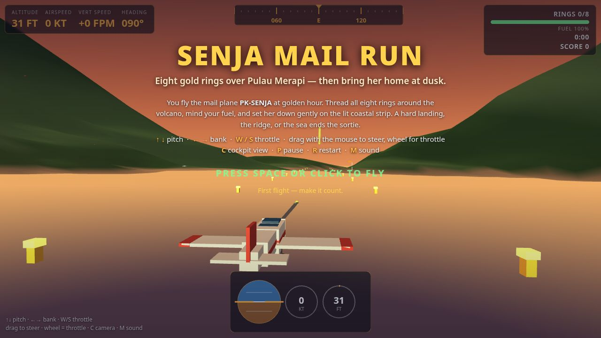
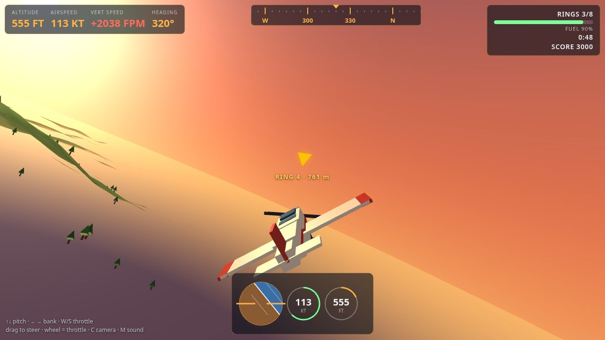
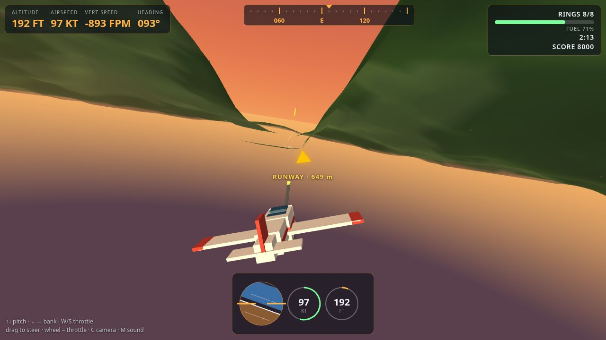
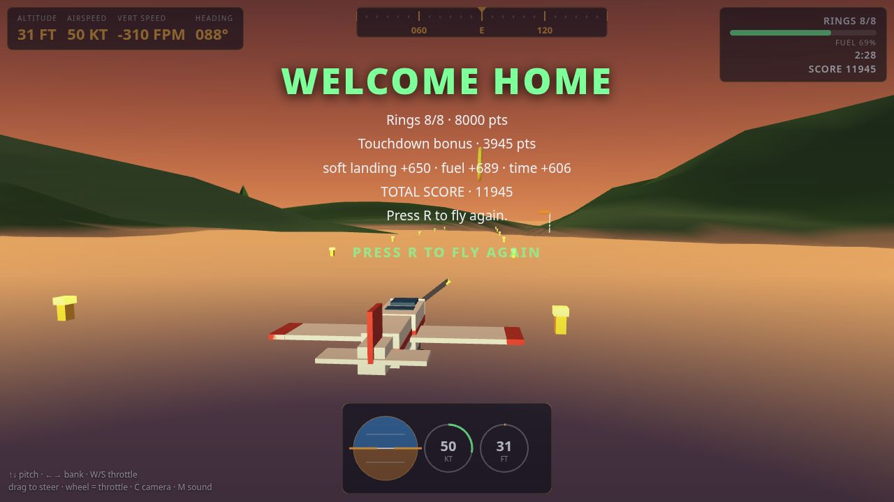

# Senja Mail Run

[](https://make.fun/bounty/best-flight-game-20261126-0057)
[](https://make.fun/bounty/best-flight-game-20261126-0057)
[](https://make.fun/bounty/best-flight-game-20261126-0057)

A golden-hour mail flight over the volcanic island **Pulau Merapi**. You fly the
little mail plane **PK-SENJA**: thread all eight gold rings around the island,
mind your fuel, then bring her home to the lit coastal strip at dusk. A hard
landing, the ridge, or the sea ends the sortie.

Built for the [Best Flight Game bounty](https://make.fun/bounty/best-flight-game-20261126-0057)
on make.fun — a hand-written WebGL flight game, zero libraries, no network.

## Play

Open `game/index.html` in a desktop browser (or serve the folder with
`node serve.ts` and open http://localhost:8080). No build step, no network —
the game is plain static files.

| Control | Action |
| --- | --- |
| ↑ / ↓ | Pitch |
| ← / → | Bank |
| W / S | Throttle |
| Mouse drag | Steer · wheel = throttle |
| Space / click | Start flying |
| C | Chase / cockpit camera |
| P | Pause · R restart · M mute |

## The flight

- **Eight gold rings** loop the island clockwise: out over the sea, up the
  north coast, around the volcano's shoulder, down the west coast, then home
  through the canyon to the strip. Each ring is worth 1,000 pts.
- **Landing** is worth up to 2,000 pts plus softness, fuel and time bonuses —
  line up on the centreline, ride the glide slope, flare over the numbers.
- **Fuel matters**: full-throttle cruise lasts about four minutes, and the
  whole loop takes about two and a half. Throttle discipline is a scoring
  decision, not decoration.
- **The island fights back**: stall below 27 m/s, sink when slow, a ridge
  between you and the strip, and a sea that forgives nothing.

The autopilot that staged the screenshots below flies the real rules — the
same physics, the same rings, the same landing — and lands with 11,945 pts.

## Shots






## Under the hood

```
game/
  index.html        entry point, HUD + overlays
  src/
    config.js       course, tuning, palette
    random.js       seeded RNG + noise
    mesh.js         mesh builders
    terrain.js      island heightfield, canyon, ocean, trees, lighthouse
    sky.js          sunset dome + clouds
    plane.js        flight model + autopilot
    rings.js        ring course + meshes
    runway.js       strip + lights
    render.js       hand-written WebGL renderer, chase + cockpit cameras
    hud.js          instruments, compass, ring arrow, overlays
    audio.js        WebAudio engine / wind / chime synth
    input.js        keyboard + mouse
    world.js        rules: rings, fuel, crash, landing, scoring
    shots.js        screenshot scenes (?shot=start|play|approach|end)
    main.js         boot + game loop
```

`main.ts` (Node 22, standard library only) copies `game/` and `screenshots/`
to the output directory and writes `dossier.json` with the vendored
`vendor/makefun-game.ts`.

## License

MIT — see [LICENSE](LICENSE).

---

Built with [make.fun](https://make.fun/r/c6yw2yzb) — try it yourself with my
referral link: https://make.fun/r/c6yw2yzb
